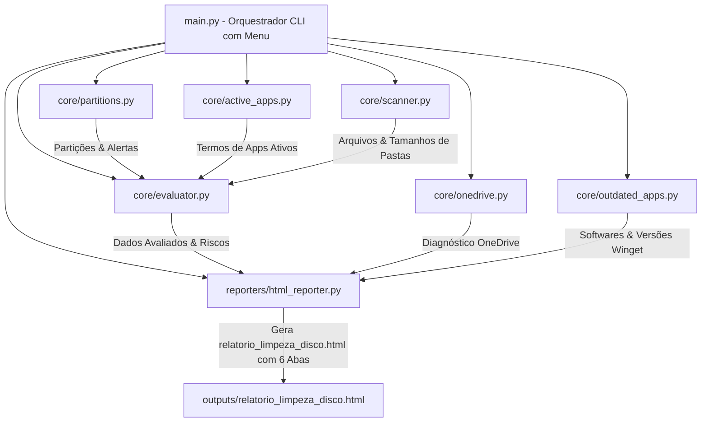

# Arquitetura Técnica & Especificação de Design

Este documento especifica a arquitetura técnica do **Analisador de Limpeza, Saúde de Discos e Atualizações de Softwares Windows**, detalhando como o sistema funciona, por que ele funciona sem gerar falsos positivos, o papel de cada módulo e as diretrizes para extensões futuras.

---

## 🏛️ Visão Geral da Arquitetura

O sistema é construído como uma aplicação Python modular e desacoplada, composta por 3 camadas principais:

---

## 🔍 Por Que Funciona? (Eliminação de Falsos Positivos)

### O Problema do Script Legado
Scripts tradicionais de varredura buscam programas instalados apenas em `C:\Program Files` ou `C:\Program Files (x86)`. No Windows moderno, softwares populares e ferramentas de desenvolvimento (como **Postman**, **Antigravity**, **VSCode**, **Discord**, **Slack**, **Zoom**, **MongoDB Compass**) são frequentemente instalados em locais alternativos, tais como:
- `%LOCALAPPDATA%\Programs\<Software>`
- `%APPDATA%\<Software>`
- Executáveis registrados exclusivamente na chave `Uninstall` do Registro do Windows ou carregados no Menu Iniciar.

Como o script legado não consultava esses locais, ele rotulava erroneamente pastas vivas e essenciais como *"Resíduos Órfãos"*.

### A Solução: Algoritmo de 5 Camadas (`core/active_apps.py`)
Antes de classificar qualquer pasta em `AppData` como órfã, o sistema consulta 5 fontes independentes de informação:

1. **Camada 1 - Registro do Windows (`winreg`)**: Varre `HKLM` e `HKCU` (32 e 64 bits) capturando `DisplayName` e `InstallLocation` de todos os programas instalados.
2. **Camada 2 - Pasta de Programas do Usuário**: Inspeciona `%LOCALAPPDATA%\Programs`.
3. **Camada 3 - Atalhos do Menu Iniciar**: Mapeia todos os nomes de programas com atalhos em `ProgramData` e `Roaming`.
4. **Camada 4 - Processos em Execução**: Executa a inspeção de processos via `tasklist` para mapear softwares em execução contínua.
5. **Camada 5 - Whitelist Dev & Produtividade**: Mantém uma lista de proteção para ecossistemas como Postman, Antigravity, VSCode, Docker, Node/npm, Python, Go, Rust, Browsers, etc.

Uma pasta só é elegível para análise de resíduo se **nenhum** termo de seu nome for encontrado em qualquer uma dessas 5 camadas.

---

## 🧩 Mapeamento de Responsabilidades Módulo a Módulo

### 1. `core/partitions.py`
- **Função**: Mapeamento dinâmico de discos.
- **Como Funciona**: Utiliza `shutil.disk_usage` iterando sobre todas as letras de drive ativas (A: a Z:).
- **Regras de Saúde**:
  - Se a partição do SO tiver ocupação >= 90%, sinaliza `Risco Crítico de Desempenho`.
  - Se a partição do SO tiver ocupação >= 80%, sinaliza `Atenção`.
  - Para partições secundárias, alerta se a ocupação ultrapassar 92%.

### 2. `core/active_apps.py`
- **Função**: Coleta de indicadores de softwares ativos.
- **Como Funciona**: Agrega os dados das 5 camadas em um único `Set[str]` em caixa baixa, otimizando buscas de alta performance.

### 3. `core/scanner.py`
- **Função**: Varredura física do sistema de arquivos.
- **Como Funciona**: Realiza um `os.walk` recursivo, ignorando pastas reservadas do sistema (`$Recycle.Bin`, `System Volume Information`, `WinSxS`, `Servicing`). Calcula o tamanho individual de arquivos e a soma acumulada de pastas.

### 4. `core/evaluator.py`
- **Função**: Classificação de risco, deduplicação e migrações.
- **Como Funciona**:
  - Classifica cada item em riscos: `Seguro / Baixo Risco (Pode Apagar)` vs `Médio Risco (Resíduo Órfão Verificado)`.
  - **Deduplicação Hierárquica**: Impede que uma pasta pai (ex: `Mozilla`) e todas as suas 50 subpastas (`Mozilla\Firefox\Profiles\...`) apareçam duplicadas no relatório, colapsando no maior nível seguro.
  - **Recomendação de Migração**: Identifica diretórios em `Program Files` no drive `C:` com tamanho > 1.5 GB e sugere transferência para partições de dados (`D:`).

### 5. `core/onedrive.py`
- **Função**: Avaliação do impacto do OneDrive.
- **Como Funciona**: Localiza as pastas do OneDrive no perfil do usuário, mede a soma dos arquivos físicos sincronizados no disco local e retorna o plano de ação de desvinculação em 3 passos.

### 6. `core/outdated_apps.py`
- **Função**: Análise de softwares desatualizados via Winget.
- **Como Funciona**: Executa `winget upgrade --include-unknown` capturando versão instalada, versão disponível, risco da atualização (patch vs major release) e o comando `winget upgrade --id <Id>`. Cruza locais de instalação no registro do Windows para indicar a partição correspondente.

### 7. `reporters/html_reporter.py`
- **Função**: Renderizador do Dashboard HTML Interativo (6 Abas).
- **Como Funciona**: Injeta a estrutura de dados JSON em um template HTML estático autônomo com CSS HSL (Dark Mode) e JavaScript Vanilla. Inclui salvamento de progresso no `localStorage` sob as chaves `resolved_disk_items` e `resolved_outdated_apps`.

---

## 🛠️ Como Estender ou Modificar o Projeto no Futuro

- **Adicionar novas ferramentas à Whitelist**: Edite a função `get_developer_whitelist()` em `core/active_apps.py`.
- **Adicionar novas regras de temporários descartáveis**: Modifique a lista `trash_indicators` em `core/evaluator.py`.
- **Modificar a detecção de atualizações**: Ajuste as regras de parsing e avaliação de risco em `core/outdated_apps.py`.
- **Alterar o visual ou estilos do relatório**: Edite as variáveis CSS `:root` e o HTML em `reporters/html_reporter.py`.
- **Adicionar um novo formato de exportação (ex: JSON, Markdown)**: Crie um novo módulo em `reporters/` (ex: `reporters/json_reporter.py`) e invoque-o em `main.py`.
