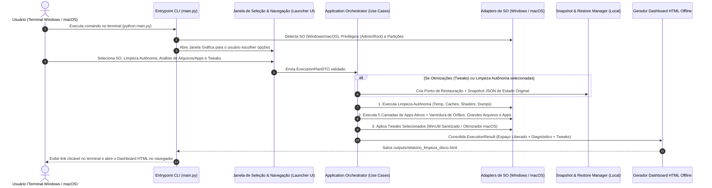
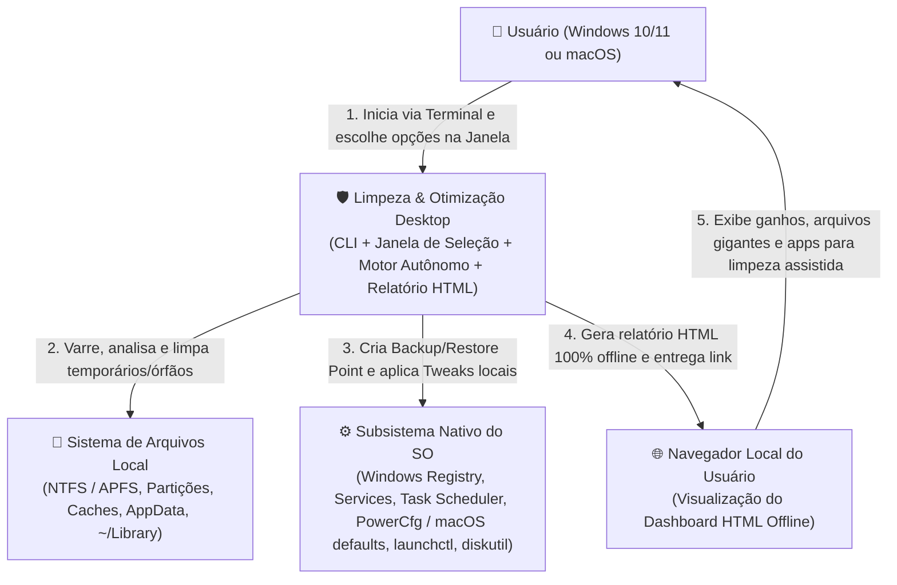
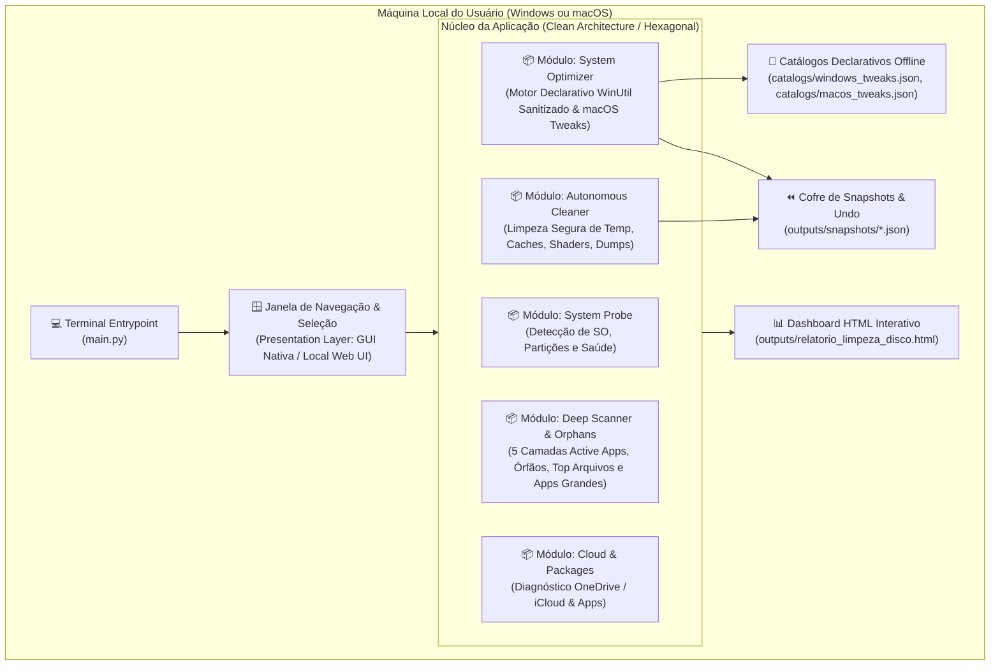
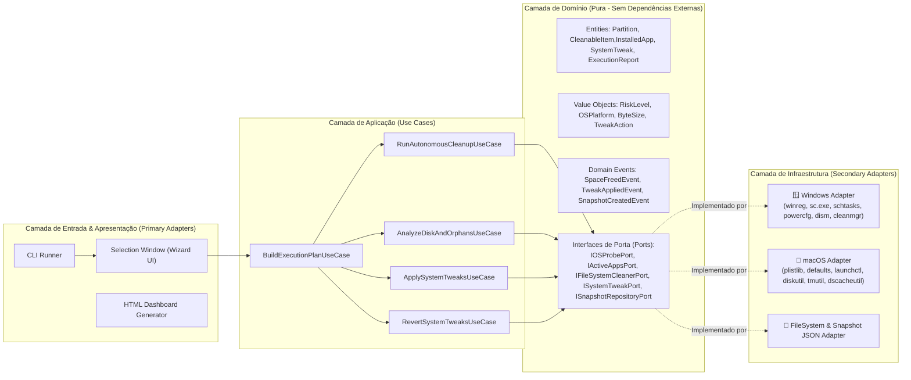

# System Design & Modelagem C4 (`limpeza-desktop`)

Este documento descreve a arquitetura de software do **Limpeza & Otimização Desktop Multiplataforma (Windows & macOS)** sob os padrões **Monólito Modular**, **Clean Architecture** e **Arquitetura Hexagonal (Ports & Adapters)**.

---

## 1. Visão Geral e Fluxo de Ponta a Ponta



---

## 2. Diagramas C4

### 2.1. Nível 1 — Diagrama de Contexto do Sistema

> [!NOTE]
> Por determinação estrita de privacidade (**RNF-01: Zero-Network Policy**), o sistema opera 100% dentro da máquina local do usuário, sem qualquer conexão com servidores na nuvem ou envio de telemetria.



---

### 2.2. Nível 2 — Diagrama de Containers (Monólito Modular)



---

### 2.3. Nível 3 — Diagrama de Componentes (Ports & Adapters)



---

## 3. Organização de Diretórios Proposta (Clean Architecture)

```text
limpeza-desktop/
├── main.py                                     # Ponto de entrada único (Terminal Windows & macOS)
├── README.md                                   # Guia de uso multiplataforma
├── docs/                                       # Documentação de Engenharia (System Design, RF/RNF, ADRs, WinUtil Audit)
│   ├── 00-INDEX.md
│   ├── requirements/
│   │   └── RF-RNF.md
│   └── architecture/
│       ├── 01-SYSTEM-DESIGN-C4.md
│       ├── 02-ADR.md
│       └── 03-WINUTIL-REVERSE-ENGINEERING-AUDIT.md
├── src/                                        # Código-fonte estruturado em Clean Architecture
│   ├── domain/                                 # Entidades puras, Value Objects, Eventos e Portas (Interfaces)
│   │   ├── entities/
│   │   ├── value_objects/
│   │   ├── events/
│   │   └── ports/
│   ├── application/                            # Casos de Uso e Orquestração (Idempotente)
│   │   ├── dtos/
│   │   ├── use_cases/
│   │   └── services/
│   ├── infrastructure/                         # Adaptadores concretos de Sistema Operacional e Persistência Local
│   │   ├── catalogs/                           # JSONs declarativos 100% offline (WinUtil sanitizado + macOS)
│   │   │   ├── windows_tweaks.json
│   │   │   ├── macos_tweaks.json
│   │   │   └── safe_cleanup_rules.json
│   │   ├── windows/                            # Adaptadores específicos Windows (winreg, services, tasks, powercfg)
│   │   ├── macos/                              # Adaptadores específicos macOS (plist, defaults, launchctl, caches)
│   │   ├── filesystem/                         # Scanner de alta performance (os.scandir) e Executor de Limpeza
│   │   └── persistence/                        # Repositório local de Snapshots/Undo e Logs de Auditoria
│   └── presentation/                           # Interfaces de Usuário
│       ├── window/                             # Janela Gráfica Inicial de Seleção (SO, Módulos, Tweaks)
│       ├── cli/                                # Formatador de progresso no terminal
│       └── reporters/                          # Gerador do Dashboard HTML Interativo Offline
├── tests/                                      # Testes Automatizados (Unitários, Arquitetura e Idempotência)
└── outputs/                                    # Relatórios HTML gerados e Snapshots de Reversão (Undo)
```
