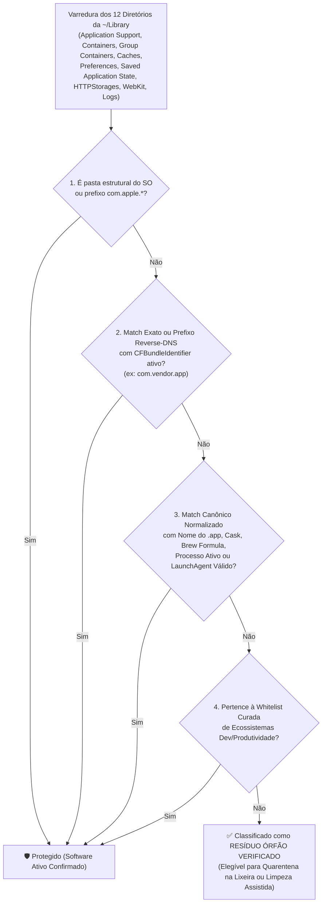

# Dossiê de Engenharia Reversa e Auditoria Zero-Network: Ecossistema macOS (Apple Silicon) & Longevidade de Hardware

Este documento registra a engenharia reversa e auditoria de privacidade/segurança realizada sobre as principais ferramentas open-source e utilitários de manutenção do ecossistema **macOS (Apple Silicon M1/M2/M3/M4 & Intel)**, detalhando:
1. **Projetos Analisados via Engenharia Reversa:** `tw93/Mole`, `mac-cleanup/mac-cleanup-py`, `alienator88/Pearcleaner`, `exelban/stats` e rotinas nativas do `Titanium Software OnyX`.
2. **Laudo de Auditoria Zero-Network:** Separação rigorosa entre o que é **Suspeito / Risco de Vazamento ou Destruição Cega de Estado (Banido)** vs. o que é **Protegido / Nativo do Subsistema Darwin/APFS (Mantido e Auditado)**.
3. **Mapeamento Técnico Completo para Transcrição Local:** Caminhos de cache, containers sandboxed, diretórios Darwin por usuário, ecossistemas de desenvolvimento, correlação estruturada por `CFBundleIdentifier`, auditoria de `LaunchAgents` órfãos e telemetria IOKit/`ioreg`.

---

## 🔍 1. PROJETOS ANALISADOS VIA ENGENHARIA REVERSA

| # | Projeto / Ferramenta | Escopo Principal Analisado | O Que Extraímos para o Nosso Motor Local |
| :--- | :--- | :--- | :--- |
| **1** | **`tw93/Mole`** (Deep Mac Cleaner CLI) & **`mac-cleanup/mac-cleanup-py`** | Scripts e módulos de limpeza profunda de caches de usuário, containers sandboxed, logs Darwin e artefatos de compilação/desenvolvimento. | Mapeamento exaustivo de diretórios de cache de desenvolvimento (`Xcode DeviceSupport`, `Archives`, `CoreSimulator`, `JetBrains`, `CocoaPods`, `uv`, `pypoetry`, `pnpm`, `Yarn`, `Bun`, `Gradle`, `Cargo`, `Go`, `Flutter`, `Playwright`) e caches de containers sandboxed (`~/Library/Containers/*/Data/Library/Caches`). |
| **2** | **`alienator88/Pearcleaner`** (Open-Source macOS App Cleaner & Orphan Detector) | Algoritmo de correlação de resíduos órfãos baseado em `CFBundleIdentifier`, convenções Reverse-DNS (`com.vendor.app`), grupos de containers e inspeção de itens de login (`LaunchAgents`). | Substituição da tokenização ingênua de palavras curtas por **Matching Estruturado em 3 Níveis** (`Bundle ID`, `Canonical Name` e `Vendor Prefix`) em 12 subdiretórios da `~/Library`, além da inspeção de binários inexistentes em `LaunchAgents`/`LaunchDaemons`. |
| **3** | **`exelban/stats`** (macOS System Monitor) & **`Titanium Software OnyX`** | Telemetria de hardware de baixo nível no Apple Silicon via IOKit (`ioreg`), `vm_stat`, `sysctl`, `diskutil` e rotinas de manutenção APFS/Darwin. | Leitura direta da controladora `AppleSmartBattery` via `ioreg -rn AppleSmartBattery -a` (`plistlib`), cálculo exato de memória unificada com páginas de `16384` bytes (`hw.pagesize`), detecção de `Purgeable Space` e snapshots APFS via `diskutil info -plist /` e `tmutil`. |

---

## 🛡️ 2. LAUDO DE AUDITORIA ZERO-NETWORK: O QUE É SUSPEITO/BANIDO VS. O QUE É PROTEGIDO

> [!IMPORTANT]
> **Política Inegociável (RNF-01):** Nenhum byte de telemetria, IP, lista de aplicativos instalados ou identificador de hardware pode sair da máquina do usuário. Todo mecanismo de auto-update remoto ou destruição cega de caches críticos de sessão foi banido.

### 2.1. 🚨 O que foi identificado como SUSPEITO ou PERIGOSO nas ferramentas originais (100% Banido)

| # | Mecanismo Identificado nos Projetos Originais | Comportamento Original | Risco Identificado | Veredito da Auditoria & Ação Tomada |
| :--- | :--- | :--- | :--- | :--- |
| **1** | **Auto-Updaters & Polling de Versão no GitHub (`Sparkle.framework` / `api.github.com`)** | `Pearcleaner`, `Stats`, `Mole` e `mac-cleanup-py` consultam `api.github.com/repos/.../releases/latest` ou feeds XML de auto-update na inicialização. | Exposição de endereço IP, User-Agent, versão do SO e frequência de uso a servidores externos sem ação explícita. | **🔴 BANIDO:** Nosso binário/script jamais realiza requisições HTTP de verificação de versão na inicialização. Zero sockets externos no runtime. |
| **2** | **Módulo de Geolocalização de IP Público e Ping Externo (`exelban/stats` Network Module)** | O módulo de rede do `Stats` consulta `https://ipinfo.io` ou faz ping para `1.1.1.1` / `8.8.8.8` para exibir IP público e latência. | Vazamento de IP público e metadados de localização física da máquina para serviços de terceiros. | **🔴 BANIDO:** Apenas métricas de hardware 100% locais e offline (`ioreg`, `sysctl`, `vm_stat`, `diskutil`) são coletadas. |
| **3** | **Exclusão Cega `rm -rf ~/Library/Caches/*` (presente em scripts shell de limpeza bruta)** | Apaga indiscriminadamente todas as pastas dentro de `~/Library/Caches/`. | Corrompe estados locais críticos do macOS: desconecta sessões do `CloudKit`/`iCloud`, invalida cache de validação `AudioUnits` (travando DAWs como Logic/Ableton) e quebra bancos SQLite em uso por daemons da Apple. | **🔴 BANIDO & SUBSTITUÍDO:** Implementada **Whitelist Cirúrgica de Proteção de Estado** (`PROTECTED_MACOS_CACHE_PATTERNS`) que preserva `CloudKit`, `nsurlsessiond`, `HomeKit`, `AudioUnitCache`, `PassKit`, `Keychain` e `GeoServices`. |
| **4** | **Remoção Automática de `LaunchAgents` sem Validação de Binário Alvo** | Alguns limpadores listam ou removem `LaunchAgents` de terceiros que estão ativos e pertencem a softwares instalados (como Docker, Raycast, 1Password). | Quebra funcionalidades essenciais de softwares ativos em background. | **🟠 SUBSTITUÍDO POR AUDITORIA DE BINÁRIO:** Um `LaunchAgent` só é classificado como **Órfão / Quebrado** se o executável apontado em `Program` ou `ProgramArguments[0]` no `.plist` **comprovadamente não existir mais no sistema de arquivos**. |
| **5** | **Uso de Kexts ou Binários C/Objective-C Compilados de Terceiros** | Utilitários de monitoramento frequentemente embarcam binários privilegiados (`SMCKit` daemon / helper tools não auditáveis). | Impossibilidade de auditoria estática em tempo de execução e necessidade de desativar proteções do sistema. | **🔴 BANIDO:** Uso estrito de Python Standard Library (`plistlib`, `subprocess`, `os`, `shutil`) invocando exclusivamente binários nativos assinados pela Apple em `/usr/bin`, `/usr/sbin` e `/bin`. |

---

### 2.2. ✅ O que é PROTEGIDO e NATIVO (Incorporado ao Nosso Motor)

| Subsistema | Ferramenta Nativa Apple / Python Stdlib | Garantia de Segurança e Privacidade |
| :--- | :--- | :--- |
| **Telemetria de Bateria & Energia** | `/usr/sbin/ioreg -rn AppleSmartBattery -a` + `plistlib.loads` | Leitura direta da árvore IOKit do kernel Darwin em formato XML Property List (< 15ms, 100% offline, zero falha de locale). |
| **Memória Unificada & Pressão VM** | `/usr/sbin/sysctl` (`hw.memsize`, `hw.pagesize`, `vm.swapusage`, `kern.memorystatus_vm_pressure_level`) + `/usr/bin/vm_stat` | Respeita a arquitetura Apple Silicon (páginas de `16384` bytes / 16 KB) e lê o nível real de pressão de memória do kernel. |
| **Diagnóstico APFS & Espaço Purgável** | `/usr/sbin/diskutil info -plist /` + `/usr/bin/tmutil listlocalsnapshots /` | Extrai com precisão `Purgeable Space`, capacidade real do container APFS e quantidade de snapshots Copy-On-Write locais. |
| **Caminhos Darwin Temporários por Usuário** | `/usr/bin/getconf DARWIN_USER_CACHE_DIR` e `DARWIN_USER_TEMP_DIR` | Localiza com segurança o sandbox `/private/var/folders/<hash>/<hash>/C` e `/T` pertencente exclusivamente ao UID do usuário atual. |
| **Quarentena via Lixeira Nativa** | `/usr/bin/osascript` (`Finder` AppleScript) + fallback seguro para `~/.Trash` com deduplicação de timestamp | Permite mover arquivos/pastas para a Lixeira antes de qualquer exclusão definitiva, garantindo reversibilidade total. |

---

## ⚙️ 3. MAPEAMENTO TÉCNICO COMPLETO DO MOTOR MACOS (APPLE SILICON M1/M2/M3/M4)

### 3.1. Limpeza Profunda de Caches de Usuário, Containers Sandboxed e Darwin User Dir

1. **Varredura Dinâmica de `~/Library/Caches/*` com Whitelist de Proteção (`mac_user_caches_general`):**
   - Limpa subpastas de aplicativos dentro de `~/Library/Caches` preservando estritamente:
     - `com.apple.nsurlsessiond`, `com.apple.bird`, `com.apple.cloudd`, `CloudKit`, `com.apple.HomeKit`, `com.apple.Safari.SafeBrowsing`, `com.apple.PassKit`, `com.apple.GeoServices`, `AudioUnitCache`, `com.apple.LaunchServices`.
2. **Caches e Logs em Containers Sandboxed (`mac_sandbox_containers_cache`):**
   - `~/Library/Containers/*/Data/Library/Caches/*`
   - `~/Library/Containers/*/Data/Library/Logs/*`
   - `~/Library/Group Containers/*/Library/Caches/*`
   - `~/Library/Group Containers/*/Library/Logs/*`
   - Recupera gigabytes retidos por apps da Mac App Store e apps sandboxed (WhatsApp, Telegram, Slack, Xcode, Docker, Final Cut Pro, Logic Pro).
3. **Caches Darwin por Usuário (`mac_darwin_user_caches`):**
   - Resolvidos dinamicamente via `getconf DARWIN_USER_CACHE_DIR` (`/private/var/folders/.../C/`) e `getconf DARWIN_USER_TEMP_DIR` (`/private/var/folders/.../T/`).
   - Alvos seguros: `com.apple.metal`, `com.apple.QuickLook.thumbnailcache`, `org.llvm.clang`, `com.apple.iconservices`.
4. **Navegadores e Apps Electron Modernos (`mac_browser_electron_cache` expandido):**
   - **Safari:** `~/Library/Caches/com.apple.Safari`, `~/Library/Caches/com.apple.WebKit.Networking`, `~/Library/Caches/com.apple.WebKit.WebContent`
   - **Arc Browser:** `~/Library/Caches/company.thebrowser.Browser`, `~/Library/Application Support/Arc/User Data/Default/Cache`, `Code Cache`, `GPUCache`
   - **Chrome / Brave / Edge / Vivaldi:** `Cache`, `Code Cache`, `GPUCache`, `Service Worker/CacheStorage`
   - **Firefox:** `~/Library/Caches/Firefox/Profiles/*/cache2`
   - **Electron & Produtividade (VS Code, Cursor, Windsurf, Discord, Slack, Spotify, Teams, Notion, Figma, Zoom, Postman):** `Cache/Cache_Data`, `Code Cache`, `GPUCache`, `CachedData`, `Service Worker/CacheStorage`, `ShipIt`.

---

### 3.2. Ecossistemas de Desenvolvimento (Dev Caches de Alto Impacto)

| Regra (`safe_cleanup_rules.json`) | Ecossistema Alvo | Diretórios e Artefatos Mapeados | Impacto Médio Recuperável |
| :--- | :--- | :--- | :--- |
| **`mac_xcode_dev_caches`** | Apple Xcode & iOS/macOS SDK | `~/Library/Developer/Xcode/DerivedData`, `~/Library/Developer/Xcode/iOS DeviceSupport`, `watchOS DeviceSupport`, `tvOS DeviceSupport`, `~/Library/Developer/CoreSimulator/Caches`, `~/Library/Caches/com.apple.dt.Xcode` | **5 GB a 80 GB** |
| **`mac_jetbrains_caches`** | JetBrains IDEs & Android Studio | `~/Library/Caches/JetBrains`, `~/Library/Logs/JetBrains`, `~/Library/Caches/Google/AndroidStudio*`, `~/Library/Logs/Google/AndroidStudio*` | **2 GB a 25 GB** |
| **`mac_node_js_caches`** | Node.js, npm, Yarn, pnpm, Bun, Cypress, Playwright | `~/.npm/_cacache`, `~/Library/Caches/Yarn`, `~/.yarn/berry/cache`, `~/Library/Caches/pnpm`, `~/.bun/install/cache`, `~/Library/Caches/Cypress`, `~/.cache/Cypress`, `~/Library/Caches/ms-playwright` | **1 GB a 30 GB** |
| **`mac_python_dev_caches`** | Python, pip, uv, Poetry, Ruff, Mypy, Pytest, Pre-commit | `~/Library/Caches/pip`, `~/.cache/pip`, `~/Library/Caches/uv`, `~/.cache/uv`, `~/Library/Caches/pypoetry`, `~/.cache/pre-commit`, `~/.cache/mypy`, `~/.cache/ruff`, `~/.cache/pytest` | **500 MB a 15 GB** |
| **`mac_jvm_native_mobile_caches`** | Gradle, Maven, Cargo (Rust), Go, CocoaPods, Flutter/Dart | `~/.gradle/caches`, `~/.gradle/daemon`, `~/.cargo/registry/cache`, `~/Library/Caches/go-build`, `~/Library/Caches/CocoaPods`, `~/.pub-cache/_temp` | **2 GB a 40 GB** |
| **`mac_homebrew_caches`** | Homebrew Package Manager | `~/Library/Caches/Homebrew`, `~/Library/Logs/Homebrew` | **500 MB a 12 GB** |
| **`mac_containers_vm_logs`** | Docker Desktop, OrbStack, Colima | `~/Library/Containers/com.docker.docker/Data/log`, `~/.orbstack/log`, `~/.colima/_lima/_networks` logs | **200 MB a 5 GB** |

---

### 3.3. Algoritmo de Correlação Estruturada de Resíduos Órfãos (Inspirado no Pearcleaner)

Para eliminar os **falsos negativos** (onde palavras curtas de 3 letras do `pkgutil --pkgs` impediam a detecção de pastas órfãs reais) e manter **zero falsos positivos**:

1. **Filtro de Tokens de `pkgutil`:** Pacotes base da Apple (`com.apple.pkg.*`) não são mais explodidos em tokens genéricos de 3 letras. Apenas o identificador completo do pacote e o identificador do produto (com `len >= 4` e fora de `GENERIC_INDICATOR_STOPWORDS`) entram no índice ativo.
2. **Exclusão de `LaunchAgents` Quebrados da Camada 3:** Um arquivo `.plist` em `LaunchAgents` cujo binário apontado em `Program` / `ProgramArguments[0]` **não existe mais no disco** não é adicionado aos indicadores de softwares ativos! Isso permite que tanques de resíduos órfãos deixados por desinstalações incompletas (arrastar `.app` para a Lixeira) sejam finalmente detectados junto com o seu `LaunchAgent` órfão.

---

### 3.4. Telemetria Nativa de Engenharia e `Longevity Health Score (0–100)`

1. **Bateria via IOKit (`ioreg -rn AppleSmartBattery -a`):**
   - Extrai via `plistlib.loads`:
     - `CycleCount` (Ciclos de carga completos)
     - `DesignCapacity` (Capacidade original de fábrica em mAh)
     - `AppleRawMaxCapacity` / `NominalChargeCapacity` (Capacidade máxima real atual em mAh)
     - `MaxCapacity` / cálculo preciso `(AppleRawMaxCapacity / DesignCapacity) * 100`
     - `Temperature` (convertido de décimos de Kelvin / centésimos para `°C`)
     - `Voltage` (`mV`) e `Amperage` (`mA` — positivo carregando, negativo descarregando)
     - `IsCharging` e `ExternalConnected`
2. **Memória Unificada Apple Silicon & Swap Thrashing:**
   - Lê `hw.pagesize` (`16384` bytes no Apple Silicon M1/M2/M3/M4 vs `4096` no Intel).
   - Extrai de `vm_stat`: `Pages active`, `Pages wired down`, `Pages occupied by compressor`, `Pages free`, `Pages speculative`, `Pageins`, `Pageouts`, `Swapins`, `Swapouts`.
   - Lê `sysctl -n kern.memorystatus_vm_pressure_level` (`1` = Normal, `2` = Warning, `4` = Critical).
3. **Storage APFS & Espaço Purgável:**
   - Executa `diskutil info -plist /` extraindo `APFSContainerFree`, `APFSContainerSize`, `PurgeableSpace` (ou via `ImportantUsage`) e conta snapshots locais via `tmutil listlocalsnapshots /`.
4. **Cálculo do `Longevity Health Score (0–100)`:**
   - **Pilar 1 — Saúde de Armazenamento, Margem Livre NAND & Snapshots (35 pontos):** Penaliza ocupação > 80% (Write Amplification no SSD), excesso de snapshots locais (> 5 snapshots) ou S.M.A.R.T. não saudável.
   - **Pilar 2 — Memória Unificada & Proteção contra Swap Thrashing no SSD (25 pontos):** Penaliza pressão de memória `Warning`/`Critical` e alto volume de swap/pageouts (que desgastam a vida útil TBW do SSD soldado na placa-mãe do Mac).
   - **Pilar 3 — Higiene de Caches, Resíduos Órfãos e Persistência de Boot (20 pontos):** Penaliza acúmulo > 5 GB de lixo/órfãos e presença de `LaunchAgents` órfãos/quebrados tentando inicializar binários inexistentes.
   - **Pilar 4 — Saúde Elétrica/Térmica (Bateria, Ciclos, Temperatura) & Pacotes (20 pontos):** Penaliza bateria com saúde < 80%, ciclos > 850, temperatura > 38 °C ou dezenas de pacotes desatualizados.
