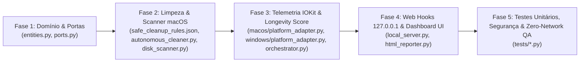

# Plano de Execução Técnico & Roadmap SDD: Limpeza Profunda macOS (Apple Silicon), Ganchos Interativos Web e Consultor de Vida Útil

> [!IMPORTANT]
> **Documento Guia de Engenharia (Specification-Driven Development):** Este plano consolida o diagnóstico de código-fonte, os contratos de domínio (Clean Architecture / Ports & Adapters), os endpoints REST locais (`127.0.0.1`) e o roteiro de implementação em 5 fases para a branch `feature/macos-deep-clean-and-interactive-health-advisor`.

---

## 1. Diagnóstico Executivo dos 8 Gargalos Atuais no macOS e na Aplicação Web

A auditoria técnica da codebase identificou 8 gargalos específicos que limitavam a recuperação de espaço no macOS Apple Silicon (M1/M2/M3/M4) e a interatividade da aplicação Web:

| # | Arquivo & Linha | Gargalo Identificado | Solução Arquitetural (RF-15, RF-16, RF-17) |
| :--- | :--- | :--- | :--- |
| **G-01** | [`src/infrastructure/catalogs/safe_cleanup_rules.json`](file:///Users/abdielcordeiro/IdeaProjects/limpeza-desktop/src/infrastructure/catalogs/safe_cleanup_rules.json#L114-L202) | Catálogo macOS possuía apenas **6 regras estáticas** com caminhos fixos (apenas 4 apps em `mac_browser_electron_cache`). Não limpava `~/Library/Caches/*` com whitelist, nem containers sandboxed (`~/Library/Containers/*/Data/Library/Caches`), nem JetBrains, CocoaPods, uv, Poetry, pnpm, Yarn, Bun, Playwright, Go ou Flutter. | Expandir o catálogo para **16+ regras cirúrgicas no macOS**, suportar resolução de wildcards (`*`) e `DARWIN_USER_CACHE_DIR` / `DARWIN_USER_TEMP_DIR` no `AutonomousCleanerAdapter` com whitelist de proteção de estado (`CloudKit`, `nsurlsessiond`, `HomeKit`, `AudioUnitCache`). |
| **G-02** | [`src/infrastructure/filesystem/disk_scanner.py`](file:///Users/abdielcordeiro/IdeaProjects/limpeza-desktop/src/infrastructure/filesystem/disk_scanner.py#L417) | Limite rígido `while queue and visited_dirs < 2500:` abortava a fila BFS prematuramente. Como `~/Library` possui >20.000 subpastas, mais de 80% da árvore ficava invisível na varredura. | Elevar o orçamento para **até `25.000` diretórios** no `DiskScannerAdapter` (parametrizável via construtor p/ testes rápidos) e usar blocos físicos APFS (`st_blocks * 512`) para medir o espaço real ocupado no SSD. |
| **G-03** | [`src/infrastructure/filesystem/disk_scanner.py`](file:///Users/abdielcordeiro/IdeaProjects/limpeza-desktop/src/infrastructure/filesystem/disk_scanner.py#L226) | `_fast_dir_size(max_files=3000)` parava de somar tamanhos de bundles `.app` e `node_modules` após 3.000 arquivos, subestimando apps como Xcode, Docker e Android Studio. | Expandir `max_files` padrão para `25000` com medição de `st_blocks * 512` no macOS e inclusão de bundles `.xcarchive`, `.simruntime` e `.framework`. |
| **G-04** | [`src/application/orchestrator.py`](file:///Users/abdielcordeiro/IdeaProjects/limpeza-desktop/src/application/orchestrator.py#L149-L160) | Escopo `SMART_FAST` no macOS não incluía `~/Library/Developer`, `~/Library/Group Containers`, `~/Library/HTTPStorages`, `~/Library/WebKit`, `~/.cache`, `~/.npm`, `~/.gradle`, `~/.cargo`, `~/.orbstack`, `~/Library/Messages/Attachments` e `MobileSync/Backup`. | Incorporar esses diretórios de alto impacto ao `SMART_FAST` do macOS e ampliar os sufixos de detecção de containers órfãos em `disk_scanner.py`. |
| **G-05** | [`src/infrastructure/macos/platform_adapter.py`](file:///Users/abdielcordeiro/IdeaProjects/limpeza-desktop/src/infrastructure/macos/platform_adapter.py#L168-L195) | `get_homebrew_and_pkgutil()` dividia pacotes `com.apple.pkg.*` em tokens de 3 letras, e `get_launch_agents_and_daemons()` incluía `.plist` de softwares já desinstalados na Camada 3, gerando falsos negativos na detecção de pastas órfãs. | Filtrar pacotes `com.apple.pkg.*`, exigir tokens significativos (`len >= 4`) e validar se o binário executável (`Program` / `ProgramArguments[0]`) do `LaunchAgent` realmente existe no disco antes de considerá-lo ativo. |
| **G-06** | [`src/infrastructure/macos/platform_adapter.py`](file:///Users/abdielcordeiro/IdeaProjects/limpeza-desktop/src/infrastructure/macos/platform_adapter.py#L438-L476) | `get_battery_health()` usava apenas `system_profiler SPPowerDataType`, onde `sppower_battery_max_capacity` retorna `"94%"` (com `%`), lançando `ValueError` em `float(max_cap)` e caindo em fallback `has_battery=False`. | Ler a controladora `AppleSmartBattery` via `ioreg -rn AppleSmartBattery -a` + `plistlib.loads` (extraindo `CycleCount`, `DesignCapacity`, `AppleRawMaxCapacity`, `Temperature`, `Voltage`, `Amperage`, `IsCharging`) e sanitizar strings com `%` no fallback. |
| **G-07** | [`src/presentation/window/local_server.py`](file:///Users/abdielcordeiro/IdeaProjects/limpeza-desktop/src/presentation/window/local_server.py#L522-L675) & [`html_reporter.py`](file:///Users/abdielcordeiro/IdeaProjects/limpeza-desktop/src/presentation/reporters/html_reporter.py) | O Dashboard Web só permitia limpeza em lote na Aba 4 (`/api/clean-selected`). Não havia botão para mover para a Lixeira/apagar arquivos gigantes ou subpastas na Aba 5, abrir no Finder/Explorer, rodar uma regra individual na Aba 2 ou gerenciar pacotes na Aba 7. | Implementar `/api/file-action` (`trash` ou `delete`), `/api/reveal-path`, `/api/execute-rule`, `/api/upgrade-packages`, `/api/startup-action`, `/api/process-action` e `/api/live-health` com atualização reativa do DOM. |
| **G-08** | [`src/domain/entities.py`](file:///Users/abdielcordeiro/IdeaProjects/limpeza-desktop/src/domain/entities.py) & [`html_reporter.py`](file:///Users/abdielcordeiro/IdeaProjects/limpeza-desktop/src/presentation/reporters/html_reporter.py#L718-L794) | A Aba 8 mostrava apenas status estático básico de hardware, sem auditar `LaunchAgents` órfãos, sem listar processos pesados/zumbis e sem um Score de Saúde e Vida Útil com recomendações acionáveis em 1 clique. | Criar `StartupItemInfo`, `ProcessDiagnosticInfo`, `LongevityRecommendation` e `LongevityScoreReport` (`0–100` em 4 pilares) com botões de ação direta na UI. |

---

## 2. Arquitetura Alvo & Contratos de Domínio (`src/domain/`)

### 2.1. Novas Entidades e Expansões em [`src/domain/entities.py`](file:///Users/abdielcordeiro/IdeaProjects/limpeza-desktop/src/domain/entities.py)

1. **`StartupItemInfo`** (Auditoria de Persistência / Boot):
   - `name: str` (ex: `com.adobe.ARMDC.Communicator.plist`)
   - `path: str` (caminho absoluto do `.plist` ou chave de Registro)
   - `scope: str` (`"User LaunchAgent"`, `"System LaunchAgent"`, `"System LaunchDaemon"`, `"Windows Startup Run"`)
   - `program_target: str` (caminho do binário extraído de `Program` / `ProgramArguments[0]`)
   - `target_exists: bool` (`True` se o executável existe no disco, `False` se órfão/quebrado)
   - `is_orphan: bool` (`not target_exists`)
   - `status_label: str` (`"⚠️ Agente Órfão (Binário Ausente)"` vs `"✅ Ativo / Binário Íntegro"`)
   - `recommendation: str`

2. **`ProcessDiagnosticInfo`** (Inspetor de Processos Pesados & Zumbis):
   - `pid: int`
   - `name: str`
   - `cpu_percent: float`
   - `memory_mb: float`
   - `memory_formatted: str`
   - `state: str` (`"Running"`, `"Sleeping"`, `"Zombie (Z)"`)
   - `is_zombie: bool`
   - `can_terminate: bool` (bloqueia processos vitais do SO como `kernel_task`, `launchd`, `WindowServer`, `System`, `csrss`, `lsass`)

3. **`LongevityRecommendation`** (Recomendação Acionável de Vida Útil):
   - `id: str`
   - `pilar: str` (`"storage_nand"`, `"memory_swap"`, `"hygiene_boot"`, `"battery_thermal"`)
   - `severity: str` (`"critical"`, `"warning"`, `"info"`, `"optimal"`)
   - `title: str` (O que foi detectado)
   - `what_to_do: str` (O que fazer / passo prático)
   - `longevity_impact: str` (Explicação de engenharia sobre como isso preserva a vida útil física do SSD/RAM/Bateria/CPU)
   - `action_type: str` (`"optimize_disk"`, `"clean_orphans"`, `"remove_broken_startup"`, `"thin_snapshots"`, `"execute_rule"`, `"terminate_zombies"`, `"none"`)
   - `action_Label: str` (Texto do botão 1-Click na UI)
   - `action_payload: Dict[str, Any]`

4. **`LongevityScoreReport`** (Score Determinístico `0–100`):
   - `total_score: int` (`0` a `100`)
   - `grade_label: str` (`"Excelente (90-100)"`, `"Bom / Saudável (75-89)"`, `"Atenção Preventiva (55-74)"`, `"Crítico / Risco de Degradação (<55)"`)
   - `storage_score: int` (máx `35`)
   - `memory_score: int` (máx `25`)
   - `hygiene_score: int` (máx `20`)
   - `thermal_battery_score: int` (máx `20`)
   - `recommendations: List[LongevityRecommendation]`

5. **Enriquecimento de `StorageDiskHealth`, `MemoryDiagnostics`, `BatteryHealth` e `HardwareHealthInfo`:**
   - `StorageDiskHealth`: adicionar `purgeable_bytes: int = 0`, `apfs_snapshots_count: int = 0`.
   - `MemoryDiagnostics`: adicionar `wired_bytes: int = 0`, `compressed_bytes: int = 0`, `cached_files_bytes: int = 0`, `pageouts_count: int = 0`, `swapouts_count: int = 0`, `page_size_bytes: int = 4096`.
   - `BatteryHealth`: adicionar `design_capacity_mah: Optional[int] = None`, `max_capacity_mah: Optional[int] = None`, `temperature_celsius: Optional[float] = None`, `voltage_mv: Optional[int] = None`, `amperage_ma: Optional[int] = None`.
   - `HardwareHealthInfo`: adicionar `startup_items: List[StartupItemInfo]`, `top_processes: List[ProcessDiagnosticInfo]`, `longevity_report: Optional[LongevityScoreReport]`.

---

## 3. Especificação dos Novos Endpoints REST Locais (`127.0.0.1`)

Todos os endpoints residem em [`src/presentation/window/local_server.py`](file:///Users/abdielcordeiro/IdeaProjects/limpeza-desktop/src/presentation/window/local_server.py), escutando exclusivamente em `127.0.0.1`:

| Método & Rota | Payload de Entrada (JSON) | Validação & Guardrails de Segurança | Retorno (JSON) |
| :--- | :--- | :--- | :--- |
| **`POST /api/file-action`** | `{"paths": ["/path/a"], "action": "trash" \| "delete", "mode": "real" \| "dry_run"}` | Valida cada caminho em `is_safe_path_to_clean(p)` e rejeita se classificado como `DO_NOT_DELETE`. Em `action="trash"`, move para `~/.Trash` (ou Recycle Bin) preservando o arquivo para recuperação. | `{"status": "ok", "action": "trash", "bytes_freed": 1048576, "bytes_freed_formatted": "1.00 MB", "affected_paths": [...], "total_freed_formatted": "...", "potential_extra_formatted": "..."}` |
| **`POST /api/reveal-path`** | `{"path": "/Users/.../Library/Caches/foo"}` | Verifica existência do caminho (ou do diretório pai), bloqueia flags de linha de comando (`-`) e executa `["open", "-R", path]` (macOS) ou `["explorer.exe", f"/select,{path}"]` (Windows) sem `shell=True`. | `{"status": "ok", "revealed": true, "path": "..."}` |
| **`POST /api/execute-rule`** | `{"rule_id": "mac_xcode_dev_caches", "mode": "real"}` | Busca a regra declarativa no catálogo por `rule_id`, executa via `AutonomousCleanerAdapter.execute_rule` e atualiza a entrada correspondente no `last_report`. | `{"status": "ok", "entry": {...}, "total_freed_formatted": "..."}` |
| **`GET /api/live-health`** | *(Query opcional `?os=macos\|windows`)* | Coleta telemetria instantânea (< 500ms) de Discos, RAM/Swap, Bateria (`ioreg`), Processos, Startup Items e recalcula o `LongevityScoreReport`. | `{"status": "ok", "hardware_health": {...}}` |
| **`POST /api/startup-action`** | `{"path": "/Users/.../Library/LaunchAgents/com.foo.plist", "action": "trash" \| "remove"}` | Só permite atuação sobre arquivos `.plist` dentro de diretórios `LaunchAgents`/`LaunchDaemons` válidos. Cria backup prévio do `.plist` em `outputs/snapshots/` antes de mover para a Lixeira/remover. | `{"status": "ok", "removed_path": "...", "backup_path": "...", "message": "..."}` |
| **`POST /api/process-action`** | `{"pid": 12345, "action": "terminate"}` | Valida que `pid > 100` e que o nome do processo não pertence à lista crítica do SO (`kernel_task`, `launchd`, `WindowServer`, `loginwindow`, `Finder`, `Dock`, `System`, `csrss`, `lsass`, `svchost`). Envia `SIGTERM` (`os.kill(pid, signal.SIGTERM)`). | `{"status": "ok", "pid": 12345, "terminated": true, "message": "..."}` |
| **`POST /api/upgrade-packages`** | `{"package_id": "node" \| "__all__" \| "__cleanup__"}` | Sanitiza `package_id` contra command injection (`^[a-zA-Z0-9._@\-\/]+$`). Executa `brew upgrade <id>`, `brew cleanup --prune=all` ou `winget upgrade --id <id>` sem `shell=True`. | `{"status": "ok", "command": "...", "output": "...", "message": "..."}` |

---

## 4. Fases de Execução (Step-by-Step Implementation Plan)

### Fase 1 — Camada de Domínio & Portas (`src/domain/`)
- Atualizar [`src/domain/entities.py`](file:///Users/abdielcordeiro/IdeaProjects/limpeza-desktop/src/domain/entities.py) com `StartupItemInfo`, `ProcessDiagnosticInfo`, `LongevityRecommendation`, `LongevityScoreReport` e os novos campos de telemetria em `StorageDiskHealth`, `MemoryDiagnostics`, `BatteryHealth` e `HardwareHealthInfo`.
- Atualizar [`src/domain/ports.py`](file:///Users/abdielcordeiro/IdeaProjects/limpeza-desktop/src/domain/ports.py) adicionando métodos para quarentena em Lixeira (`move_paths_to_trash`), inspeção de processos/startup (`get_startup_items`, `get_top_processes`, `remove_startup_item`, `terminate_process`) e manutenção de pacotes.

### Fase 2 — Motor de Limpeza Cirúrgica e Scanner Profundo macOS (`src/infrastructure/filesystem/` & `catalogs/`)
- Expandir [`src/infrastructure/catalogs/safe_cleanup_rules.json`](file:///Users/abdielcordeiro/IdeaProjects/limpeza-desktop/src/infrastructure/catalogs/safe_cleanup_rules.json) com as regras completas para macOS Apple Silicon (Caches Gerais com Whitelist, Containers Sandboxed, Darwin User Caches, Navegadores/Electron modernos, Xcode completo, JetBrains/Android Studio, Node/JS, Python/uv/Poetry, JVM/Gradle/Rust/Go/CocoaPods/Flutter, Homebrew e Containers/VMs).
- Evoluir [`src/infrastructure/filesystem/autonomous_cleaner.py`](file:///Users/abdielcordeiro/IdeaProjects/limpeza-desktop/src/infrastructure/filesystem/autonomous_cleaner.py):
  - Suportar tokens especiais `@DARWIN_USER_CACHE_DIR@` e `@DARWIN_USER_TEMP_DIR@` resolvidos com segurança via `getconf` e autorizados em `is_safe_path_to_clean()` exclusivamente quando pertencentes ao subdiretório do usuário em `/private/var/folders/`.
  - Suportar expansão de wildcards (`glob.glob`) em `target_paths` (ex: `~/Library/Containers/*/Data/Library/Caches` e `~/Library/Caches/*`) aplicando `PROTECTED_MACOS_CACHE_PATTERNS` para nunca apagar `CloudKit`, `nsurlsessiond`, `HomeKit`, `AudioUnitCache`, `Keychain`, etc.
  - Implementar `move_paths_to_trash(paths, mode)` para mover arquivos e pastas para `~/.Trash` (macOS) ou Recycle Bin (Windows) com resolução automática de conflito de nomes.
- Evoluir [`src/infrastructure/filesystem/disk_scanner.py`](file:///Users/abdielcordeiro/IdeaProjects/limpeza-desktop/src/infrastructure/filesystem/disk_scanner.py):
  - Aumentar orçamento padrão `max_visited_dirs: int = 25000` e `max_bundle_files: int = 25000`.
  - Medir tamanho físico no macOS com `st_blocks * 512` (quando `st_blocks` disponível e `> 0`) para precisão em APFS.
  - Expandir `is_direct_orphan_container` para os 12 subdiretórios da `~/Library` (`Application Support`, `Containers`, `Group Containers`, `Caches`, `Preferences`, `Saved Application State`, `HTTPStorages`, `WebKit`, `Logs`, `Cookies`, `Application Scripts`).

### Fase 3 — Telemetria Nativa Apple Silicon, Auditor de Startup/Processos & Consultor de Vida Útil (`src/infrastructure/macos/`, `windows/`, `application/`)
- Evoluir [`src/infrastructure/macos/platform_adapter.py`](file:///Users/abdielcordeiro/IdeaProjects/limpeza-desktop/src/infrastructure/macos/platform_adapter.py):
  - Em `MacOSActiveAppsAdapter`: filtrar `com.apple.pkg.*` de `pkgutil`, exigir tokens `>= 4` chars e ignorar `LaunchAgents` cujo binário alvo não exista mais no disco.
  - Em `MacOSHardwareProbeAdapter`:
    - `get_battery_health()`: ler `ioreg -rn AppleSmartBattery -a` via `plistlib.loads` com fallback resiliente no `system_profiler` (removendo `%` antes de `float()`).
    - `get_memory_diagnostics()`: usar `hw.pagesize` (`16384` no Apple Silicon), extrair `wired`, `compressed`, `cached`, `pageouts`, `swapouts` e `kern.memorystatus_vm_pressure_level`.
    - `get_disks_health()`: extrair `PurgeableSpace` via `diskutil info -plist /` e contar snapshots APFS locais via `tmutil listlocalsnapshots /`.
    - `get_startup_items()`: auditar `~/Library/LaunchAgents`, `/Library/LaunchAgents` e `/Library/LaunchDaemons` verificando a existência física de `Program` / `ProgramArguments[0]`.
    - `get_top_processes()`: executar `ps -axo pid,ppid,stat,%cpu,%mem,rss,comm` listando os Top 10 processos e identificando zumbis (`Z`).
- Adicionar suporte equivalente em [`src/infrastructure/windows/platform_adapter.py`](file:///Users/abdielcordeiro/IdeaProjects/limpeza-desktop/src/infrastructure/windows/platform_adapter.py) e implementar o cálculo determinístico de `LongevityScoreReport` e `LongevityRecommendation` no [`OrchestratorService`](file:///Users/abdielcordeiro/IdeaProjects/limpeza-desktop/src/application/orchestrator.py).

### Fase 4 — Ganchos Interativos Web & Dashboard UI Reativo (`src/presentation/`)
- Implementar os 7 novos endpoints em [`src/presentation/window/local_server.py`](file:///Users/abdielcordeiro/IdeaProjects/limpeza-desktop/src/presentation/window/local_server.py): `/api/file-action`, `/api/reveal-path`, `/api/execute-rule`, `/api/live-health`, `/api/startup-action`, `/api/process-action`, `/api/upgrade-packages`.
- Evoluir [`src/presentation/reporters/html_reporter.py`](file:///Users/abdielcordeiro/IdeaProjects/limpeza-desktop/src/presentation/reporters/html_reporter.py):
  - **Aba 2 (Limpeza Autônoma):** Botão `"🧹 Limpar Esta Regra Agora"` para cada regra simulada ou com espaço pendente.
  - **Aba 4 (Pastas Órfãs & Caches):** Seletor de modo `"🗑️ Mover para Lixeira (Seguro)"` vs `"🔥 Excluir Permanentemente"` + botão `"📂 Abrir Local"` por linha.
  - **Aba 5 (Top 100 Maiores Arquivos & Pastas + Subpastas):** Botões `"📂 Abrir Local"`, `"🗑️ Mover p/ Lixeira"` e `"🔥 Excluir"` em cada item e subpasta elegível (desabilitado automaticamente para itens `🚫 Não Apagar`).
  - **Aba 7 (Cloud & Atualizações):** Botões `"⬆️ Atualizar Pacote"`, `"🚀 Atualizar Todos"` e `"🧹 Limpar Cache Brew/Winget"`.
  - **Aba 8 (Saúde de Hardware, Longevidade & Processos):**
    - Painel de destaque do **Score de Saúde & Vida Útil (`0–100`)** com barras dos 4 pilares e botão `"🔄 Atualizar Telemetria em Tempo Real"`.
    - Grid de **Recomendações Acionáveis de Vida Útil** ("O Que Fazer", "Impacto Físico no Hardware" e botão de execução 1-Clique).
    - Métricas expandidas de Bateria (`mAh`, `mV`, `mA`, `°C`, `Ciclos`), Memória Unificada (`Wired`, `Compressed`, `Swapouts`, `Page Size`) e APFS (`Espaço Purgável`, `Snapshots Locais`).
    - Tabela Interativa de **Agentes de Inicialização & Persistência (`LaunchAgents` / `Startup`)** destacando órfãos com botão `"🗑️ Remover Agente Órfão (c/ Backup)"`.
    - Tabela Interativa de **Top Processos Consumidores & Zumbis** com botão `"🛑 Encerrar Processo"`.
  - **Rigor Visual (Prevenção de Overflow):** Uso estrito de `white-space: nowrap` em métricas, badges, tamanhos e percentuais; `min-width: 0; max-width: 100%; overflow: hidden; box-sizing: border-box` em cards; e `display: inline-flex; align-items: center; gap: 8px` em checkboxes/radios.

### Fase 5 — Bateria de Testes Automatizados, Segurança & Zero-Network QA (`tests/`)
- Criar e expandir testes unitários e de integração cobrindo RF-15, RF-16 e RF-17.
- Validar que `tests/test_privacy_audit.py` (auditoria AST Zero-Network) passa com 100% de conformidade.

---

## 5. Matriz de Rastreabilidade (Requisitos x ADRs x Código x Testes)

| Requisito | ADR Relacionado | Arquivos de Produção Impactados | Arquivos de Teste Automatizado |
| :--- | :--- | :--- | :--- |
| **RF-15** (Limpeza Cirúrgica macOS, Containers, Darwin Caches, Dev Ecosystems, BFS 25k & Bundle-ID Correlation) | **ADR-009** | `src/infrastructure/catalogs/safe_cleanup_rules.json` `src/infrastructure/filesystem/autonomous_cleaner.py` `src/infrastructure/filesystem/disk_scanner.py` `src/infrastructure/macos/platform_adapter.py` `src/application/orchestrator.py` | `tests/test_cleaner_and_scanner.py` `tests/test_macos_deep_clean_and_webhooks.py` `tests/test_security_and_edge_cases.py` |
| **RF-16** (Ganchos Interativos Web: `/api/file-action`, `/api/reveal-path`, `/api/execute-rule`, `/api/upgrade-packages`, Quarentena na Lixeira) | **ADR-010** | `src/presentation/window/local_server.py` `src/presentation/reporters/html_reporter.py` `src/application/orchestrator.py` `src/infrastructure/filesystem/autonomous_cleaner.py` | `tests/test_report_and_server.py` `tests/test_macos_deep_clean_and_webhooks.py` `tests/test_security_and_edge_cases.py` |
| **RF-17** (Telemetria IOKit `ioreg`, Auditor de `LaunchAgents` Órfãos, Inspetor de Processos e `Longevity Health Score 0–100`) | **ADR-009** **ADR-010** | `src/domain/entities.py` `src/domain/ports.py` `src/infrastructure/macos/platform_adapter.py` `src/infrastructure/windows/platform_adapter.py` `src/application/orchestrator.py` `src/presentation/reporters/html_reporter.py` | `tests/test_hardware_and_storage_optimization.py` `tests/test_macos_deep_clean_and_webhooks.py` `tests/test_privacy_audit.py` |
| **RF-18** (Raio-X Real das Categorias Ocultas de Armazenamento: "Documentos 18,67 GB" & "Dados do Sistema 148,52 GB", Pastas Ocultas `~/.*`, Artefatos Reconstruíveis de Projetos `node_modules`/`.venv`/`target`/`build` e Ativação Padrão de Caches Dev) | **ADR-011** | `src/domain/entities.py` `src/domain/ports.py` `src/infrastructure/catalogs/safe_cleanup_rules.json` `src/infrastructure/filesystem/autonomous_cleaner.py` `src/infrastructure/filesystem/disk_scanner.py` `src/application/orchestrator.py` `src/presentation/reporters/html_reporter.py` | `tests/test_cleaner_and_scanner.py` `tests/test_macos_deep_clean_and_webhooks.py` |
| **RF-19** (Explorador Interativo de Árvore de Diretórios Sob Demanda `POST /api/inspect-directory` com Drill-Down Infinito) | **ADR-011** | `src/domain/entities.py` `src/domain/ports.py` `src/infrastructure/filesystem/disk_scanner.py` `src/application/orchestrator.py` `src/presentation/window/local_server.py` `src/presentation/reporters/html_reporter.py` | `tests/test_report_and_server.py` `tests/test_security_guardrails_audit.py` |

---

## 6. Plano Cirúrgico de Execução V2 (Para Subagente Flash 3.8 High) — Desvendando os `18,67 GB` de "Documentos" e os `148,52 GB` de "Dados do Sistema" (RF-18 & RF-19 / ADR-011)

### 6.1. Diagnóstico de Causa-Raiz da Imagem (`219,68 GB / 245,11 GB usados`)

1. **Por que o macOS marca `18,67 GB` em "Documentos", mas o navegador nativo do macOS não mostra onde estão?**
   - O daemon `storagekitd` do macOS contabiliza em **"Documentos"** tudo o que reside em `/Users/<usuario>` (`~`) fora de `~/Library`, Fotos, Mail e Mensagens.
   - Entretanto, a janela nativa do macOS (botão `ⓘ` em Documentos) **oculta 100% dos diretórios ocultos (`~/.*`)** (`~/.gemini`, `~/.cursor`, `~/.vscode`, `~/.ollama`, `~/.lmstudio`, `~/.docker`, `~/.orbstack`, `~/.nvm`, `~/.pyenv`, `~/.sdkman`, `~/.rustup`, `~/.cargo`, `~/.m2`, `~/.gradle`, `~/.npm`, `~/.bun`, `~/.pub-cache`, `~/.cocoapods`, `~/.android`, `~/.local`, `~/.config`) e não agrega pastas de projetos (`~/IdeaProjects`, `~/Projects`, `~/Documents`, `~/Desktop`) formadas por milhares de arquivos pequenos (`node_modules`, `.venv`, `venv`, `target`, `build`, `.dart_tool`, `.next`, `dist`, `.git`).
   - **Por que nosso app não trouxe isso antes?** Em [`src/application/orchestrator.py`](file:///Users/abdielcordeiro/IdeaProjects/limpeza-desktop/src/application/orchestrator.py#L197-L218), o escopo padrão `SMART_FAST` possuía uma lista estática que **não incluía `~/Documents`, `~/Desktop`, `~/IdeaProjects` nem a descoberta dinâmica das pastas ocultas `~/.*`**!
2. **Por que os `148,52 GB` de "Dados do Sistema" (`System Data`) ficavam numa caixa-preta e a remoção evoluiu pouco?**
   - Em [`src/infrastructure/catalogs/safe_cleanup_rules.json`](file:///Users/abdielcordeiro/IdeaProjects/limpeza-desktop/src/infrastructure/catalogs/safe_cleanup_rules.json#L244-L359), as regras de maior impacto para desenvolvedores (`mac_jetbrains_caches`, `mac_node_js_caches`, `mac_python_dev_caches`, `mac_jvm_native_mobile_caches`, `win_dev_caches`) estavam com `"default_enabled": false`!
   - Em [`src/infrastructure/filesystem/autonomous_cleaner.py`](file:///Users/abdielcordeiro/IdeaProjects/limpeza-desktop/src/infrastructure/filesystem/autonomous_cleaner.py#L891), `execute_rule()` chamava `_clean_directory_contents(expanded, mode=mode, remove_root=False)` mesmo quando `expanded` vinha de um wildcard (`~/Library/Caches/*`), deixando subpastas vazias e não limpando `@DARWIN_USER_CACHE_DIR@/*` nem múltiplos perfis (`Profile *`) de navegadores.
   - Em [`src/infrastructure/filesystem/disk_scanner.py`](file:///Users/abdielcordeiro/IdeaProjects/limpeza-desktop/src/infrastructure/filesystem/disk_scanner.py#L462), `node_modules` e artefatos de build eram medidos com `_fast_dir_size()`, mas **não eram adicionados em `clean_candidates`**, e a deduplicação pai-filho com `sub_occupants[:5]` de apenas 1 nível impedia o usuário de explorar subpastas profundas.

---

### 6.2. Roteiro Exato de Implementação Passo a Passo (Blueprint para Flash 3.8 High)

#### Passo 1: Novas Entidades de Raio-X e Inspeção de Diretório em [`src/domain/entities.py`](file:///Users/abdielcordeiro/IdeaProjects/limpeza-desktop/src/domain/entities.py) e [`src/domain/ports.py`](file:///Users/abdielcordeiro/IdeaProjects/limpeza-desktop/src/domain/ports.py)
1. Em `src/domain/entities.py`, adicionar:
   - **`DirectoryInspectionNode`**:
     - `name: str`, `path: str`, `size: int`, `size_formatted: str`, `percent_of_parent: float`, `item_type: str` (`"Pasta"` | `"Arquivo"`), `is_hidden: bool`, `safety_action: str`, `safety_badge: str`, `safety_recommendation: str`, `can_delete: bool`, `children_count: int = 0`.
     - Método `to_dict() -> Dict[str, Any]`.
   - **`StorageCategoryBreakdown`** (representa uma fatia do Raio-X, ex: *"Pastas Ocultas na Home (`~/.*` — Espaço Fantasma de Documentos)"*, *"Projetos & Pastas Visíveis (`~/Documents`, `~/IdeaProjects`)"*, *"Artefatos Reconstruíveis de Projetos (`node_modules`, `.venv`, `target`, `build`)"*, *"Containers, VMs & Docker/OrbStack"*, *"Application Support & IDEs"*, *"Caches & Subsistema Darwin"*, *"SDKs, Simuladores & Toolchains"*, *"Homebrew & Package Stores Globais"*, *"Modelos de IA & Agentes Locais"*, *"Swap, Memória Virtual & Snapshots APFS"*):
     - `category_id: str`
     - `title: str`
     - `os_equivalent: str` (`"Documentos (macOS Storage)"` ou `"Dados do Sistema / System Data"`)
     - `total_bytes: int`
     - `total_formatted: str`
     - `description: str`
     - `why_os_hides_it: str`
     - `top_items: List[Dict[str, Any]] = field(default_factory=list)` (lista dos maiores diretórios/arquivos dentro desta categoria com `name`, `path`, `size`, `size_formatted`, `safety_action`, `safety_badge`, `can_delete`).
     - Método `to_dict() -> Dict[str, Any]`.
   - **`StorageXRayReport`**:
     - `documents_total_bytes: int = 0`
     - `documents_visible_bytes: int = 0`
     - `documents_hidden_dotfiles_bytes: int = 0`
     - `documents_rebuildable_artifacts_bytes: int = 0`
     - `system_data_tracked_bytes: int = 0`
     - `categories: List[StorageCategoryBreakdown] = field(default_factory=list)`
     - Properties formatadas (`documents_total_formatted`, `documents_visible_formatted`, `documents_hidden_dotfiles_formatted`, `documents_rebuildable_artifacts_formatted`, `system_data_tracked_formatted`) e `to_dict()`.
   - Em **`SystemExecutionReport`**:
     - Adicionar campo opcional `storage_xray: Optional[StorageXRayReport] = None` e serializá-lo em `to_dict()["storage_xray"]`.
2. Em `src/domain/ports.py` (`IDiskScannerPort`):
   - Adicionar métodos:
     - `build_storage_xray(os_platform: OSPlatform, partitions: List[PartitionInfo], hardware_health: Optional[HardwareHealthInfo] = None) -> StorageXRayReport`
     - `inspect_directory(dir_path: str, os_platform: OSPlatform, max_items: int = 30) -> Dict[str, Any]`

#### Passo 2: Catálogo `safe_cleanup_rules.json` e Limpeza Efetiva em `autonomous_cleaner.py`
1. Em [`src/infrastructure/catalogs/safe_cleanup_rules.json`](file:///Users/abdielcordeiro/IdeaProjects/limpeza-desktop/src/infrastructure/catalogs/safe_cleanup_rules.json):
   - Mudar `"default_enabled": true` para:
     - `mac_jetbrains_caches`
     - `mac_node_js_caches` (incluindo também `~/Library/pnpm/store/v3/tmp`, `~/.npm/_logs`)
     - `mac_python_dev_caches`
     - `mac_jvm_native_mobile_caches` (incluindo também `~/.gradle/caches`, `~/.gradle/daemon`, `~/.m2/repository/.cache`)
     - `win_dev_caches`
   - Em `mac_darwin_user_caches`: adicionar `"@DARWIN_USER_CACHE_DIR@/*"` para limpar todos os caches Darwin por usuário reconstruíveis (respeitando `PROTECTED_MACOS_CACHE_PATTERNS`).
   - Em `mac_browser_electron_cache`: adicionar suporte a múltiplos perfis Chromium (`~/Library/Caches/Google/Chrome/*/Cache`, `~/Library/Caches/Google/Chrome/*/Code Cache`, `~/Library/Application Support/Google/Chrome/*/Service Worker/CacheStorage`, `~/Library/Application Support/Google/Chrome/*/GPUCache`, `~/Library/Caches/BraveSoftware/Brave-Browser/*/Cache`, `~/Library/Application Support/Windsurf/Cache/Cache_Data`, `~/Library/Application Support/Windsurf/CachedData`, `~/Library/Application Support/Antigravity/Cache/Cache_Data`, `~/Library/Application Support/Antigravity/Code Cache`, `~/Library/Application Support/Postman/proxy`).
2. Em [`src/infrastructure/filesystem/autonomous_cleaner.py`](file:///Users/abdielcordeiro/IdeaProjects/limpeza-desktop/src/infrastructure/filesystem/autonomous_cleaner.py):
   - Em `execute_rule()` (linha 891): quando `has_wildcard=True` (ex: `~/Library/Caches/*` ou `@DARWIN_USER_CACHE_DIR@/*`), passar `remove_root=True` para `_clean_directory_contents(expanded, mode=mode, remove_root=has_wildcard)` para que as subpastas de cache expandidas pelo wildcard sejam efetivamente removidas por completo (e não deixadas como esqueletos de diretórios vazios).
   - Em `_clean_directory_contents()`: ao medir arquivos no macOS, se `os.path.islink(fpath)` apontar para um arquivo de cache real ou arquivo normal, contabilizar corretamente e continuar garantindo proteção total a raízes do usuário via `is_safe_path_to_clean()`.

#### Passo 3: Varredura Completa da Home (`~`), Detecção de Artefatos Reconstruíveis (`node_modules`, `.venv`, `target`, `build`) e Motor de Raio-X em `disk_scanner.py` e `orchestrator.py`
1. Em [`src/application/orchestrator.py`](file:///Users/abdielcordeiro/IdeaProjects/limpeza-desktop/src/application/orchestrator.py#L192-L219) (`_resolve_scan_targets`):
   - No modo `SMART_FAST` (macOS e Windows), descobrir dinamicamente **todos os diretórios de 1º nível dentro de `~` (`os.path.expanduser("~")`)** (excluindo apenas `~/Library` como raiz única pois `~/Library` já tem seus subdiretórios-chave listados e `~/.Trash` para evitar prompt TCC desnecessário no scan), garantindo que:
     - `~/Documents`, `~/Desktop`, `~/Downloads`, `~/IdeaProjects`, `~/Projects`, `~/Developer`, `~/Workspace`, `~/Movies`, `~/Music`, `~/Pictures` sejam SEMPRE escaneados!
     - Todos os `dot-folders` existentes em `~` (`~/.gemini`, `~/.cursor`, `~/.vscode`, `~/.ollama`, `~/.lmstudio`, `~/.docker`, `~/.orbstack`, `~/.colima`, `~/.nvm`, `~/.pyenv`, `~/.sdkman`, `~/.rustup`, `~/.cargo`, `~/.m2`, `~/.gradle`, `~/.npm`, `~/.bun`, `~/.pub-cache`, `~/.cocoapods`, `~/.android`, `~/.local`, `~/.config`, `~/.cache`, etc.) sejam SEMPRE escaneados!
     - Também incluir `/Library/Developer` e `/opt/homebrew` (se existirem) na análise de ocupantes/Raio-X!
2. Em [`src/infrastructure/filesystem/disk_scanner.py`](file:///Users/abdielcordeiro/IdeaProjects/limpeza-desktop/src/infrastructure/filesystem/disk_scanner.py):
   - Definir conjunto de **Artefatos Reconstruíveis de Projeto**:
     `REBUILDABLE_PROJECT_ARTIFACTS = {"node_modules", ".venv", "venv", "target", "build", ".dart_tool", ".next", ".nuxt", "dist", "pods", "__pycache__", ".pytest_cache", ".mypy_cache", ".ruff_cache", ".tox", ".Parcel-cache", ".turbo", "deriveddata"}`
   - No loop BFS de `scan_and_evaluate()` (linha 462):
     - Quando `dir_base in REBUILDABLE_PROJECT_ARTIFACTS` (ou `dir_base.endswith((".app", ".xcarchive", ".simruntime"))` ou `dir_base == ".git"`):
       - Medir `agg_size = _fast_dir_size(current_dir, max_files=self.max_bundle_files)` e propagar `agg_size` para `folder_sizes[current_dir]` e seus ancestrais (`for parent in path_obj.parents`).
       - **NOVO:** Se `dir_base in REBUILDABLE_PROJECT_ARTIFACTS` e `agg_size >= max(self.min_orphan_bytes, 5 * 1024 * 1024)` (ou `>= self.min_orphan_bytes` para respeitar testes parametrizados) e o caminho não estiver dentro de `/Applications/*.app` ou `/System`:
         - Adicionar um `CleanableItem` em `clean_candidates` com:
           - `name= f"{os.path.basename(os.path.dirname(current_dir))}/{os.path.basename(current_dir)}"`
           - `path=current_dir`
           - `item_type="Artefato Reconstruível de Projeto (Build / Dependências)"`
           - `risk_level="Seguro / Reconstruível (npm install / pip / build)"`
           - `risk_badge="info"`
           - `reason=f"Diretório '{os.path.basename(current_dir)}' dentro do projeto '{os.path.basename(os.path.dirname(current_dir))}'. Ocupa espaço na categoria 'Documentos' do macOS e pode ser recriado a qualquer momento."`
           - `how_to_fix="Mova para a Lixeira ou exclua se não estiver trabalhando ativamente neste projeto agora."`
           - `is_orphan=False`
   - Expandir `sub_occupants` de `direct_children[:5]` para `direct_children[:12]` e incluir campos `safety_action`, `safety_badge` e `can_delete` em cada sub-ocupante.
   - Implementar **`build_storage_xray(os_platform, partitions, hardware_health)`** em `DiskScannerAdapter`:
     - Escaneia de forma rápida e direcionada as raízes que compõem **"Documentos (`~` fora de `~/Library`)"** e **"Dados do Sistema (`~/Library`, `/Library`, `/opt/homebrew`, `/private/var/vm`, `@DARWIN_USER_CACHE_DIR@`)"**:
       1. **Categoria 1 (`doc_visible_projects`) — Pastas Visíveis & Projetos na Home (`~/Documents`, `~/IdeaProjects`, `~/Desktop`, `~/Downloads`, etc.):** lista cada pasta visível em `~` (exceto `Library` e `Applications`) com seu tamanho real, percentual e top subpastas.
       2. **Categoria 2 (`doc_hidden_dotfiles`) — Pastas Ocultas na Raiz do Usuário (`~/.*` — "O Espaço Fantasma de Documentos"):** mede todas as pastas iniciadas com `.` em `~` (exceto `.Trash`), explicando claramente: *"O Ajustes do Sistema do macOS soma estas pastas ocultas dentro da categoria 'Documentos' (seus 18,67 GB), mas o Finder e o navegador de armazenamento da Apple as escondem por começarem com ponto (.)."*
       3. **Categoria 3 (`doc_rebuildable_artifacts`) — Dependências & Builds Reconstruíveis em Projetos (`node_modules`, `.venv`, `target`, `build`, `.dart_tool`):** soma todos os artefatos de build encontrados nos projetos do usuário.
       4. **Categoria 4 (`sys_containers_vms`) — Containers Sandboxed, Docker, OrbStack & VMs (`~/Library/Containers`, `Group Containers`, `~/.orbstack`, `~/.docker`):** lista os maiores containers (WhatsApp, Docker, Xcode, Slack, Telegram, etc.).
       5. **Categoria 5 (`sys_app_support`) — Application Support, IDEs & Bancos de Estado (`~/Library/Application Support`):** lista os maiores diretórios (`Code`, `Cursor`, `JetBrains`, `Google/Chrome`, `MobileSync/Backup`, etc.).
       6. **Categoria 6 (`sys_caches_darwin`) — Caches de Usuário, Logs & Subsistema Darwin (`~/Library/Caches`, `~/Library/Logs`, `@DARWIN_USER_CACHE_DIR@`):** lista os maiores caches.
       7. **Categoria 7 (`sys_dev_toolchains_pkgs`) — SDKs, Simuladores, Homebrew & Stores de Pacotes (`~/Library/Developer`, `/Library/Developer`, `/opt/homebrew`, `~/Library/pnpm`, `~/Library/Android`):** mede Xcode, CoreSimulator Devices/Images, Homebrew Cellar/Caskroom, Android SDK, pnpm store.
       8. **Categoria 8 (`sys_vm_snapshots_ai`) — Memória Virtual/Swap, Snapshots APFS, Espaço Purgável & Modelos Locais de IA (`/private/var/vm`, `PurgeableSpace`, `~/.ollama`, `~/.lmstudio`, `~/.cache/huggingface`):** mostra exatamente quanto do "Dados do Sistema" é Swap/Sleepimage + Espaço Purgável APFS + Modelos LLM.
   - Implementar **`inspect_directory(dir_path, os_platform, max_items=30)`** em `DiskScannerAdapter`:
     - Valida caminho seguro (sem `..` ou `\x00`, existe e `os.path.isdir(dir_path)`).
     - Itera com `os.scandir(dir_path)` listando todas as subpastas e arquivos imediatos, calculando tamanho físico (`_fast_dir_size(entry.path, max_files=12000)` para pastas e `_effective_file_size` para arquivos).
     - Ordena por `size` decrescente, calcula `percent_of_parent`, classifica com `classify_item_safety` e define `can_delete = is_safe_path_to_clean(entry.path) and safety_action != SafetyClassification.DO_NOT_DELETE.value`.
     - Retorna dicionário com `current_path`, `parent_path`, `name`, `total_bytes`, `total_formatted`, `items: [DirectoryInspectionNode.to_dict(), ...]`.

#### Passo 4: Novo Endpoint `POST /api/inspect-directory` em [`src/presentation/window/local_server.py`](file:///Users/abdielcordeiro/IdeaProjects/limpeza-desktop/src/presentation/window/local_server.py) e Método no [`OrchestratorService`](file:///Users/abdielcordeiro/IdeaProjects/limpeza-desktop/src/application/orchestrator.py)
1. Em `OrchestratorService`:
   - Durante `execute_plan()`, chamar `storage_xray = self.scanner.build_storage_xray(plan.os_platform, final_partitions, hardware_health)` e anexar ao `SystemExecutionReport(storage_xray=storage_xray)`.
   - Adicionar método `inspect_directory(target_path: str, max_items: int = 30) -> Dict[str, Any]` que delega para `self.scanner.inspect_directory(...)`.
2. Em `LocalControlPanelServer.dispatch_request()` (`src/presentation/window/local_server.py`):
   - Adicionar rota **`POST /api/inspect-directory`**:
     - Recebe `{"path": "...", "max_items": 30}`.
     - Rejeita com HTTP `400` se `path` vazio, contiver `\x00` ou segmento `..`.
     - Chama `self.orchestrator.inspect_directory(target_path, max_items=max_items)` e retorna `200` com o JSON da árvore daquela pasta.

#### Passo 5: Nova Seção "🔍 Raio-X Real do Armazenamento (Desvendando 'Documentos' & 'Dados do Sistema') + Explorador de Pastas Interativo" no Dashboard HTML ([`src/presentation/reporters/html_reporter.py`](file:///Users/abdielcordeiro/IdeaProjects/limpeza-desktop/src/presentation/reporters/html_reporter.py))
1. Na **Aba 1 (`tab-overview`)**, logo abaixo dos cards de Partições e antes do Log de Auditoria:
   - Renderizar o painel **"🔍 Raio-X Real do Armazenamento: O Que Está Ocupando 'Documentos' e 'Dados do Sistema'"**:
     - **3 KPIs de Destaque no Topo do Raio-X:**
       1. `📄 Total Real na Pasta Pessoal (~ / "Documentos" do macOS)`: exibe `documents_total_formatted`, dividindo em:
          - `Pastas Visíveis & Projetos`: `documents_visible_formatted`
          - `👻 Pastas Ocultas (~/.* invisíveis no Ajustes do macOS)`: `documents_hidden_dotfiles_formatted`
          - `🧱 Builds & node_modules/.venv Reconstruíveis`: `documents_rebuildable_artifacts_formatted`
       2. `⚙️ Total Mapeado em "Dados do Sistema" (System Data)`: exibe `system_data_tracked_formatted`
       3. `🧹 Potencial Imediato Recuperável`: `REPORT_DATA.potential_extra_bytes_formatted`
     - **Grid dos 8 Cards de Categorias do Raio-X (`REPORT_DATA.storage_xray.categories`):**
       - Cada card mostra o título da categoria, badge indicando se o macOS classifica aquilo como `Documentos` ou `Dados do Sistema`, tamanho total formatado, explicação de *por que o macOS esconde ou acumula aquilo*, e a lista dos **Top Diretórios Culpados** dentro daquela categoria.
       - Em cada diretório listado nos cards do Raio-X, exibir 3 botões de ação direta:
         - `🔍 Explorar Pasta` (abre o **Modal / Painel Explorador de Árvore Interativo** chamando `inspectDirectory(path)`)
         - `📂 Finder/Explorer` (`revealPath(path)`)
         - `🗑️ Lixeira` (`fileAction(path, 'trash')`, exibido apenas quando `can_delete === true`)
2. **Explorador Interativo de Árvore de Diretórios (Drill-Down Infinito — `inspectDirectory(path)`):**
   - Criar na Aba 1 (e acessível de qualquer botão `🔍 Explorar` da Aba 1 e Aba 5) um painel/modal interativo **"📂 Explorador Cirúrgico de Diretórios (Drill-Down Nivel a Nível)"**:
     - Exibe **Breadcrumb clicável** do caminho atual (ex: `/Users` > `abdielcordeiro` > `IdeaProjects` > `projeto-x`) + botão `⬆️ Subir um Nível`.
     - Lista todas as subpastas e arquivos daquela pasta ordenados do maior para o menor tamanho, com barra proporcional (`%`), badge de classificação (`🚫 Não Apagar`, `✅ Limpeza Direta`, `⚠️ Avaliar Conteúdo Pessoal`, `⚙️ Desinstalar`), botão `🔍 Entrar na Pasta` (para continuar descendo quantos níveis quiser!), botão `📂 Abrir Local`, botão `🗑️ Lixeira` e botão `🔥 Excluir`.
     - Ao mover um item para a Lixeira ou excluí-lo dentro do Explorador, remove a linha reativamente e recalcula o diretório!

#### Passo 6: Testes Automatizados e Auditoria Zero-Network (`tests/`)
- Adicionar testes unitários cobrindo:
  1. `DiskScannerAdapter.build_storage_xray()` validando a separação exata entre pastas visíveis (`~/Documents`, `~/IdeaProjects`), pastas ocultas (`~/.gemini`, `~/.gradle`, etc.) e categorias de `Dados do Sistema`.
  2. Detecção de `node_modules`, `.venv`, `target`, `build` como `CleanableItem` do tipo `"Artefato Reconstruível de Projeto (Build / Dependências)"`.
  3. `DiskScannerAdapter.inspect_directory()` e endpoint `POST /api/inspect-directory` (com proteção contra path traversal `..` e ordenação decrescente por tamanho).
  4. `AutonomousCleanerAdapter.execute_rule()` com `remove_root=True` em alvos de wildcard (`/*`) e verificação de `default_enabled=True` nas regras de cache de desenvolvimento em `safe_cleanup_rules.json`.
  5. Validação `node --check` no JS gerado pelo `html_reporter.py` e `tests/test_privacy_audit.py` 100% verde.

